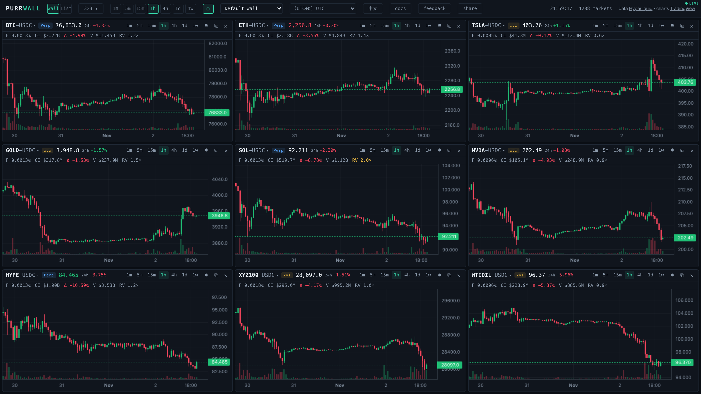

# Purrwall

[](https://github.com/lvdou26/purrwall/actions/workflows/ci.yml)
[](LICENSE)

**Every Hyperliquid market, one wall.** A free multi-chart price wall for
Hyperliquid: perps, spot, HIP-3 builder markets (stocks, commodities, indices,
FX) and HIP-4 outcome markets, 1 to 24 live charts side by side in the
browser.

**Live at [purrwall.xyz](https://purrwall.xyz).** English and Chinese UI.



Hyperliquid's own app shows one chart at a time. Purrwall puts up to 24 of
them, from any of its markets, on one screen — and keeps every one of them
live.

## What it does

- **1–24 charts (up to 6×4).** Any market in any cell; drag a cell's header
  onto another to swap them.
- **Every market.** Perps, spot, HIP-3 and HIP-4, picked from a selector that
  mirrors Hyperliquid's own: same tabs, columns, sorting, favorites and
  keyboard navigation.
- **Formulas.** Chart `HYPE/ETH`, `BTC-ETH` or `(BTC+ETH)/2` as live
  candles, up to 4 markets per formula.
- **Linked wall.** Hover one chart and every chart marks the same moment;
  zoom or pan one and the others follow, across intervals. ⌖ in the top bar
  toggles the link.
- **Full history.** Scroll left for everything Hyperliquid keeps: about 5000
  bars per interval, daily candles back to 2020.
- **Stats and alerts.** 24h change, funding, open interest and volume (market
  cap on spot) in every cell; price alerts by level or by % move, with an
  in-page notice plus optional sound and browser notification, while a
  Purrwall tab is open.
- **Watch an address.** Paste a Hyperliquid address to draw its entries,
  liquidation prices and resting orders on every chart, with a Positions page
  beside the wall.
- **List view.** Every market in one live, sortable table with 24h trend
  glyphs: [purrwall.xyz/#list](https://purrwall.xyz/#list).
- **Saved walls and sharing.** The address bar is the layout: send the link
  and the other person sees your wall. Saved walls can sync between devices
  with an 8-character pairing code.
- **Phones.** 1–3 columns, hold-and-drag to swap, pull to refresh; installs as
  a web app.

## How it works

- The browser talks to Hyperliquid directly. Market lists and candle history
  come from its REST API through one client that caps concurrency, merges
  duplicate requests and retries; one shared WebSocket carries live candles,
  prices and watched-address state.
- A cell loads its most recent bars, then streams. Scrolling left pages in
  older history; after a reconnect or a hidden tab, a cell fetches only the
  gap.
- Formula cells fetch and stream each leg under its real market id and
  compose the bars in the browser.
- A small Cloudflare Worker (`worker/`) serves the static build and three
  JSON routes: `/api/sync` (saved walls between devices), `/api/feedback`
  (the in-app feedback box) and `/api/sparks` (the list view's trend glyphs,
  built by [purrwall-data](https://github.com/lvdou26/purrwall-data)).
- A scheduled workflow checks the Hyperliquid API shapes the app relies on
  and syncs two lists from Hyperliquid's own app: the spot display names and
  the curated spot list behind the picker's Strict filter.
- One JavaScript bundle (about 205 KB gzipped, CSS included) and canvas charts.

Details, invariants and what a fork needs to change:
[docs/architecture.md](docs/architecture.md).

## Run it locally

Requires Node 22.12 or later.

```bash
npm ci
npm run dev       # http://localhost:5173
npm run lint
npm test          # vitest, pure logic
npm run build     # typecheck + production build + release check
npm run perf      # cold-start budget on the built dist/ (needs Chrome; set CHROME_PATH if it is not found)
```

`npm run dev` talks to Hyperliquid directly, and its list view reads the
trend glyphs from purrwall.xyz. The sync and feedback routes need the
Worker: run `npx wrangler dev` (the pinned wrangler) after `npm run build`; a
production build served locally shows the list without glyphs.

## Project layout

```
src/lib/hl/       Hyperliquid client: REST, WebSocket, market catalog, formulas
src/lib/          app logic: share URLs, sync, alerts, i18n, linked crosshair
src/components/   wall cells, market table and picker, list and positions views
worker/           Cloudflare Worker: /api/sync, /api/feedback, /api/sparks
scripts/          API canary, spot-list sync, perf smoke, release check
docs/             architecture notes
```

## Contributing

Issues and pull requests are welcome. Start with
[CONTRIBUTING.md](CONTRIBUTING.md); [docs/architecture.md](docs/architecture.md)
explains how the pieces fit and the invariants the code depends on. Coding
agents read [AGENTS.md](AGENTS.md).

## License

Code: [MIT](LICENSE). Charts: TradingView Lightweight Charts™, Apache-2.0 —
see [NOTICE](NOTICE); pages that render charts keep a link to TradingView, as
that license requires. Market data: [Hyperliquid](https://app.hyperliquid.xyz)
public API.

TradingView Lightweight Charts™ · Copyright © 2025 [TradingView, Inc.](https://www.tradingview.com/)
